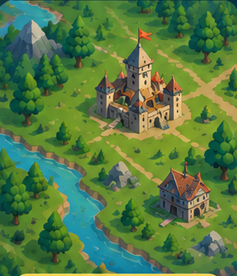

# სასწავლო სტრატეგიული თამაში — დიზაინ-დოკუმენტი

> **სტატუსი:** იდეის / დიზაინის ეტაპი
> **ბოლო განახლება:** 2026-11-03
>
> ეს ფაილი არის პროექტის მთავარი "ხედვის" დოკუმენტი. აქ ინახება ყველა იდეა, გადაწყვეტილება და სამომავლო გეგმა.
> აღნიშვნები:
> - ✅ **გადაწყვეტილია** — ავტორმა დაადასტურა
> - 💡 **შემოთავაზება** — ჯერ არ არის დადასტურებული, განსახილველია
> - ❓ **ღია კითხვა** — უნდა გადაწყდეს მოგვიანებით

---

## 1. ხედვა (მოკლედ)

ბრაუზერის თამაში მობილურისთვის, სადაც მომხმარებელი **სტრატეგიული თამაშის** (სასახლეები, ჯარი, მეფე) გარემოში
**ქართულ ენაზე** სწავლობს:
- უცხო ენას, რომელსაც თავად აირჩევს;
- სასკოლო საგნებს — მათემატიკა, გეოგრაფია, ქიმია და სხვ.

თამაში უნდა იყოს ისეთი, რომ სწავლა იყოს თამაშის ნაწილი და არა მისგან ცალკე.

---

## 2. პლატფორმა

| # | რა | სტატუსი |
|---|----|---------|
| 2.1 | მობილური ბრაუზერი — მთავარი პლატფორმა | ✅ |
| 2.2 | დესკტოპ ბრაუზერშიც უნდა მუშაობდეს | 💡 |
| 2.3 | მომავალში — აპლიკაცია (Android / iOS) | ✅ (მომავალი ეტაპი) |

💡 რეკომენდაცია: თავიდანვე ავაწყოთ როგორც **PWA** (ვებ-აპი, რომელიც ტელეფონზე "დაყენდება" როგორც აპი),
შემდეგ კი იგივე კოდი **Capacitor**-ით გადავიტანოთ Play Store / App Store-ში — თამაშის თავიდან დაწერა არ დაგვჭირდება.

### 2.1 სამიზნე ბაზარი
✅ **ვიწყებთ საქართველოთი (ქართულენოვანი მომხმარებელი), შემდეგ — ინგლისური და სხვა ენები** (გადაწყვეტილია 2026-11-02).

არგუმენტები:
- ქართულ ენაზე ხარისხიანი სასწავლო თამაში თითქმის არ არსებობს → კონკურენცია მცირეა, ადვილია გამორჩევა.
- ინგლისურენოვან ბაზარზე უკვე არიან დიდი მოთამაშეები (Duolingo, Prodigy — მათემატიკის RPG, Kahoot, Khan Academy) და რეკლამა ძვირია.
- ქართული ბაზარი პატარაა, მაგრამ იაფი და კარგია "საცდელ პოლიგონად": სკოლები, მშობლები, ქართული მედია / ბლოგერები, დიასპორა.
- კოდი თავიდანვე მრავალენოვანი (i18n) იქნება → ინგლისურის დამატება მოგვიანებით არ გაძვირდება.
- 💡 სამომავლო ნიშა: სხვა "დავიწყებული" ენები, რომლებზეც დიდი აპები არ ასწავლიან (სტრატეგია: ვიყოთ საუკეთესო იქ, სადაც დიდები არ არიან).

---

## 3. სასწავლო შინაარსი

### 3.1 ინტერფეისის ენა (რა ენაზე სწავლობს მომხმარებელი)
- ✅ **ქართული** — პირველი და მთავარი
- ✅ **სწავლების (ინტერფეისის) ენები:** ქართული, ინგლისური, თურქული, სომხური, აზერბაიჯანული, რუსული, ყაზახური, უზბეკური
  (ავტორის გადაწყვეტილება; მომხმარებელს ყველაფერი მშობლიურ ენაზე ეხსნება)
- ❓ ყაზახური და უზბეკური საჭიროა თუ რუსული საკმარისია? ავტორის კითხვაზე პასუხი: რუსული ყაზახეთში ფართოდ იციან,
  უზბეკეთში — გაცილებით ნაკლებად (განსაკუთრებით ახალგაზრდებმა და სოფლად); ბავშვებისთვის მშობლიური ენა სჯობს.
  💡 რეკომენდაცია: ორივე დარჩეს სიაში; გაშვების რიგში რუსული შეიძლება იყოს ადრე, ყაზახური/უზბეკური — მოგვიანებით.
- ❓ რა რიგით ჩაირთვება ენები (ჯერ ქართული, შემდეგ...)?

💡 ტექნიკური შენიშვნა: ყველა ტექსტი თავიდანვე უნდა იყოს ცალკე ფაილებში (i18n), რომ ახალი ენის დამატება მარტივი იყოს.

### 3.2 შესასწავლი ენები
- ✅ მომხმარებელი თვითონ ირჩევს, რომელი ენა ისწავლოს
- ✅ **პირველი ენა: ინგლისური** (გადაწყვეტილია 2026-11-02)
- ✅ **ენები, რომლებსაც ვასწავლით:** ინგლისური, ესპანური, გერმანული, ფრანგული (ავტორის გადაწყვეტილება)
- ❓ მომავალში კიდევ სხვა ენები? (მაგ. რუსული, იტალიური, ...)

### 3.4 სწავლების ფორმა — ტესტები ✅
- ✅ სწავლა მიმდინარეობს **ტესტების ფორმით** (ავტორის გადაწყვეტილება); ტესტებითვე მიმდინარეობს ბრძოლაც.
- კითხვების ტიპები (💡 შემოთავაზება): ერთი სწორი პასუხი, რამდენიმე სწორი პასუხი, მართალია/მცდარია, გამოტოვებული სიტყვა,
  დაწყვილება, წინადადების აწყობა, მოსმენა, დროშის არჩევა, რუკაზე ჩვენება, სურათით (ღირსშესანიშნაობა).
- ფაილის ფორმატი და ნიმუშები: `content/README.md`, `content/schema/question.schema.json`, `content/subjects/`.

### 3.3 სასკოლო საგნები
- ✅ **გეოგრაფიაში ვასწავლით:** ქვეყნები და დედაქალაქები, **ქვეყნების გეოგრაფიული მდებარეობა**, დროშები, რუკები,
  ღირსშესანიშნაობები (ავტორის გადაწყვეტილება, 2026-11-02)
- ✅ **პირველი საგანი: გეოგრაფია** (ინგლისურთან ერთად; გადაწყვეტილია 2026-11-02)
- ✅ მათემატიკა
- ✅ გეოგრაფია
- ✅ ქიმია
- ✅ სხვა საგნები (სია დასაზუსტებელია)
- ❓ რომელი კლასებისთვის / ასაკისთვის? ქართული სასკოლო პროგრამის მიხედვით?

---

## 4. თამაშის ჟანრი და სამყარო

- ✅ სტრატეგიული თამაში
- ✅ სასახლეები / ციხე-სიმაგრეები
- ✅ ჯარი
- ✅ მეფე (მოთამაშის პერსონაჟი / სამეფოს მმართველი)

❓ ღია კითხვები:
- როგორ უკავშირდება სწავლა თამაშს? (რას იღებს მოთამაშე სწორი პასუხისთვის?)
- აქვს თუ არა თამაშს რესურსები (ოქრო, ხე, ქვა, საკვები)?
- როგორ ვითარდება სამეფო — შენობების აშენება/გაძლიერება?

💡 შემოთავაზებები განსახილველად:
- სწორი პასუხები → რესურსები (ოქრო, ხე, ქვა), რომლითაც აშენებ სასახლეს და წვრთნი ჯარს.
- თითოეული საგანი = სამეფოს ცალკე შენობა (მაგ. "ალქიმიკოსის კოშკი" — ქიმია, "რუკების დარბაზი" — გეოგრაფია,
  "ხაზინა" — მათემატიკა, "ელჩების სასახლე" — უცხო ენები). შენობის დონე = ამ საგნის ცოდნის დონე.
- ჯარისკაცების ტიპები შეიძლება დამოკიდებული იყოს იმაზე, რომელ საგანს სწავლობ.

---

## 5. ბრძოლის სისტემა

- ✅ ბრძოლის **საკუთარი, თავისებური სტილი** (დეტალები — მოგვიანებით)
- ✅ ოფლაინ ბრძოლა **ბოტთან** (თვითონ საიტთან)
- ✅ ონლაინ ბრძოლა:
  - ✅ მეგობრებთან
  - ✅ საიტის სხვა მომხმარებლებთან

- ✅ თამაში იქნება **როგორც ოფლაინ, ისე ონლაინ** — ეს მთავარ გვერდზეც წერია („როგორ თამაშობ“).

> 📌 ავტორის შენიშვნა: ბრძოლის დეტალებზე ვისაუბრებთ, როცა ამ ეტაპამდე მივალთ.

❓ ღია კითხვები (მოგვიანებით):
- როგორ ერევა სწავლა ბრძოლაში? (მაგ. კითხვაზე სწორი/სწრაფი პასუხი = ძლიერი შეტევა?)
- რეალურ დროში თუ სვლებით (turn-based)?
- რეიტინგი / ლიგები?

---

## 6. ვიზუალური სტილი

### 6.1 რეფერენსი

ფაილი: [references/style-ref-01-castle-map.png](references/style-ref-01-castle-map.png)

### 6.2 სტილის აღწერა (რეფერენსის მიხედვით)
- **ხედი:** იზომეტრიული / ზემოდან დახრილი (2.5D)
- **სტილი:** სტილიზებული, "ნახატის" მსგავსი (painterly), რბილი, ფერადი, "მყუდრო" ფენტეზი
- **ფერები:** ნათელი მწვანე მინდვრები, მუქი მწვანე ნაძვები, ცისფერი მდინარე, ყავისფერი ბილიკები,
  ნაცრისფერ-ბეჟი ქვის სასახლეები **წითელ-ნარინჯისფერი სახურავებით**
- **ობიექტები:** შუა საუკუნეების ციხე-სასახლე დროშით, სოფლის სახლები, ნაძვები, კლდეები, მთები, მდინარე, ბილიკები
- **განწყობა:** თბილი, მეგობრული, ბავშვისთვისაც და უფროსისთვისაც მიმზიდველი

### 6.3 ინტერფეისის (UI) სტილი 💡
- ხის ჩარჩოები, პერგამენტის (ძველი ქაღალდის) ფანჯრები, ოქროსფერი ღილაკები
- დიდი, თითით ადვილად დასაჭერი ღილაკები (მობილური!)
- UI-ს (მენიუები, ღილაკები, პანელები) აწყობა კოდით (HTML/CSS) შეიძლება — ამას ცალკე სურათები არ სჭირდება

---

## 7. გრაფიკის შექმნის გეგმა

კოდი ხატავს **არა** თავად სურათებს, არამედ **ათავსებს** მზა სურათებს (PNG/WebP) ეკრანზე, ამოძრავებს და ურთიერთქმედებს მათთან.
ამიტომ გრაფიკა ცალკე უნდა მოვიპოვოთ / შევქმნათ — **ცალ-ცალკე ობიექტებად** (ასეტებად), გამჭვირვალე ფონით:

| ასეტი | მაგალითი |
|-------|----------|
| მიწის ფილები (tiles) | ბალახი, ბილიკი, წყალი, ნაპირი |
| შენობები (დონეების მიხედვით) | სასახლე დონე 1, 2, 3... ; სახლი; კოშკი |
| დეკორაცია | ნაძვები, კლდეები, მთები, დროშები |
| ერთეულები (ჯარი) | მეომარი, მშვილდოსანი, მხედარი, მეფე |
| UI | ჩარჩოები, ღილაკები, ხატულები (ოქრო, ხე, ქვა) |

### გზები (ვარიანტები)
1. **AI გენერაცია** — სწრაფი და იაფი. ინსტრუმენტები: Scenario.gg (სპეციალურად თამაშის ასეტებისთვის, ერთიან სტილს ინარჩუნებს),
   Leonardo.ai, Midjourney (`--sref` სტილის რეფერენსით), **ChatGPT** და **Gemini** (რეფერენსის ატვირთვით). ფონის მოშორება: remove.bg / Photoroom.
   ⚠️ შეამოწმე კომერციული გამოყენების პირობები.
   - ChatGPT/Gemini: კარგია ცალკეული ობიექტებისთვის; სუსტია — სტილის სრული ერთგვაროვნება ბევრ ასეტზე, ზუსტი იზომეტრიული კუთხე,
     ერთმანეთზე გადაბმული ფილები და ანიმაციის კადრები. ყოველ ჯერზე რეფერენსი თავიდან ატვირთე და ერთი და იგივე პრომპტის შაბლონი გამოიყენე.
2. **მზა ასეტ-პაკეტების ყიდვა** — itch.io, CraftPix.net, GameDev Market, Unity Asset Store (2D isometric medieval).
   ⚠️ შეამოწმე ლიცენზია (კომერციული გამოყენება, აპლიკაციაში გამოყენება).
3. **მხატვრის დაქირავება** — ArtStation, Fiverr, Upwork, ან ქართველი ილუსტრატორი. ყველაზე ხარისხიანი და ერთიანი სტილი, ყველაზე ძვირი.
4. **3D → 2D** — Blender-ში მოდელები, რენდერი იზომეტრიული კუთხით. ერთიანი სტილი და ანიმაციები მარტივდება, მაგრამ 3D ცოდნა სჭირდება.

💡 რეკომენდაცია: პროტოტიპისთვის — **AI გენერაცია ან მზა პაკეტი**; თამაშის გაშვებამდე — მხატვარი, რომელიც ერთიან სტილს მოიყვანს წესრიგში.

✅ **გადაწყვეტილია (2026-11-02):** ჯერ თამაში აეწყობა **დროებითი, კოდით დახატული გრაფიკით** (placeholder),
საბოლოო გრაფიკა კი მოგვიანებით ჩანაცვლდება. ამისთვის:
- რუკა ინახება როგორც **მონაცემები** (ფილების ბადე + ობიექტების ადგილები), გრაფიკისგან ცალკე;
- ყველა სურათი ერთ სიაშია (asset manifest) — ახალი გრაფიკის ჩასმა = ამ სიაში ფაილების შეცვლა;
- ფილის ზომა თავიდანვე ფიქსირდება (💡 მაგ. იზომეტრიული 128×64 px), რომ შეკვეთილი/დაგენერირებული გრაფიკა ზუსტად მოერგოს.

⚠️ რეფერენსის სურათი (6.1) გამოიყენება **მხოლოდ სტილის ორიენტირად** — თამაშში პირდაპირ ჩასმა არ შეიძლება, თუ მასზე უფლება არ გვაქვს.

---

## 8. ტექნოლოგიები 💡 (შემოთავაზება, ჯერ არ არის დადასტურებული)

| ნაწილი | შემოთავაზება | რატომ |
|--------|-------------|-------|
| თამაშის ძრავი | **Phaser** (JavaScript/TypeScript) | 2D/იზომეტრიული თამაშებისთვის, მობილურ ბრაუზერში კარგად მუშაობს |
| ალტერნატივა | PixiJS / Babylon.js (თუ 3D გვინდა) | |
| ენა | TypeScript | ნაკლები შეცდომა დიდ პროექტში |
| მობილური აპი | PWA → Capacitor | ერთი კოდი ბრაუზერისთვის და აპისთვის |
| ონლაინ ბრძოლა | WebSocket სერვერი (მაგ. Colyseus) | მოგვიანებით, ბრძოლის ეტაპზე |
| ბაზა / ანგარიშები | მოგვიანებით გადასაწყვეტი | |

### 8.1 რაც უკვე აწყობილია ✅ (2026-11-02)
- **საიტი:** სუფთა HTML/CSS/JS მოდულები, build-ის გარეშე; კომპონენტები `src/components/<სახელი>/` (html + module.css + js);
  საერთო მდგომარეობა `src/core/state.js`, თარგმანები `src/i18n/`; გაშვება: `npm run dev` ან Live Server. დეტალები: `docs/ARCHITECTURE.md`.
- **ბაზა:** PostgreSQL სქემა — `database/schema.sql` (მომხმარებლები, საგნები/თემები/კითხვები, პროგრესი, სამეფო, მეგობრები, ბრძოლები).
- **შინაარსი:** ტესტები JSON-ში — `content/`.
- ❓ თამაშის ძრავი (Phaser) და TypeScript — გადასაწყვეტია, როცა თამაშის ეკრანებზე გადავალთ.

---

## 9. შემოსავლის მოდელი

✅ **რეგისტრაცია უფასოა** (გადაწყვეტილია 2026-11-02).

💡 შემოსავლის მოდელი: **Freemium**
- ფასიანი შესვლა მკვეთრად ამცირებს მომხმარებლების რაოდენობას (ბავშვებს ბარათი არ აქვთ, უცნობ თამაშში ფულს ცოტა იხდის),
  ონლაინ ბრძოლებს კი ბევრი მოთამაშე სჭირდება. $1-იან გადახდას საკომისიოც დიდი ნაწილს "ჭამს".
- შემოსავლის წყაროები (შემოთავაზება):
  1. **პრემიუმ გამოწერა** (თვიური/წლიური) — მაგ. ყველა საგანი/ენა, მეტი ენერგია, რეკლამის გარეშე, დამატებითი რეჟიმები
  2. **კოსმეტიკა** — სასახლის / დროშის / ჯარის / მეფის იერსახე (არ აძლიერებს ბრძოლაში)
  3. **სეზონური საპრიზო გზა (Battle Pass)**
  4. **მშობლებისთვის** — ოჯახის ლიცენზია, მშობლის პანელი
     ✅ (2026-11-03) მასწავლებლები / სკოლები ცალკე როლი არ იქნება — ყველა ჩვეულებრივი მომხმარებელია (მასწავლებლის პანელი, კლასის ანგარიში — არა).
  5. **რეკლამა** — ფრთხილად: ბავშვებისთვის რეკლამაზე მკაცრი წესებია (Google Play Families, მონაცემთა დაცვის კანონები)
     - ❓ **Google H5 Games Ads** (2026-11-02): სრულეკრანიანი და დაჯილდოებითი რეკლამა მხოლოდ HTML5 **თამაშებისთვისაა** — ჩვეულებრივ
       ვებგვერდზე (ტესტი როგორც ფორმა) არ მოქმედებს. საჭიროა: დამტკიცებული AdSense ანგარიში + განაცხადი ბეტაზე
       (adsense.google.com/start/h5-beta); დამტკიცება გარანტირებული არ არის.
     - 💡 გეგმა: ტესტები არ იყოს ვებ-ფორმები — იყოს **თამაშის ნაწილი** ცალკე თამაშის აპლიკაციაში (`/play`, თამაშის ძრავი,
       დონეები, ბრძოლის რაუნდები, ჯილდოები); მთავარი/ინფო გვერდები — ჩვეულებრივი საიტი. სრულეკრანიანი რეკლამა — მხოლოდ
       ბუნებრივ შესვენებებზე (დონეებს / ბრძოლებს შორის); დაჯილდოებითი — მოთამაშის არჩევით (მაგ. +ოქრო, მინიშნება, დამატებითი სიცოცხლე).
     - ⚠️ ბავშვები: ბავშვებზე მიმართული შინაარსი Google-თან უნდა მოინიშნოს (child-directed) — პერსონალიზებული რეკლამა ითიშება;
       რეგისტრაციაზე ასაკის კითხვა (ბაზაში `users.birth_year`). H5 რეკლამის წესები ბავშვებისთვის — დასაზუსტებელია AdSense-თან.
- ❌ არ ვყიდით ბრძოლაში უპირატესობას (pay-to-win) — ონლაინ ბრძოლა სამართლიანი უნდა იყოს.
- ❓ ძირითადი სწავლა რჩება უფასო, თუ ნაწილი პრემიუმშია?

---

## 10. განვითარების ეტაპები (Roadmap)

- [x] **ეტაპი 0 — იდეა და დიზაინი**
  - [x] ძირითადი ხედვის ჩაწერა, ვიზუალური რეფერენსის შენახვა
  - [x] სამიზნე ბაზარი (საქართველო → სხვა ქვეყნები), შემოსავლის მოდელი (უფასო რეგისტრაცია, Freemium)
  - [x] საგნები: ინგლისური, ესპანური, გერმანული, ფრანგული, გეოგრაფია; სწავლების ფორმა — ტესტები; ოფლაინ + ონლაინ
  - [x] სწავლების (ინტერფეისის) 8 ენა — თარგმანები მზადაა
  - [ ] სწავლა ↔ თამაში კავშირის საბოლოო გადაწყვეტა (ოქრო / რესურსები / შენობები — ჯერ 💡)
  - [ ] თამაშის ეკრანების დიზაინი (სამეფოს რუკა, სასახლე, გაკვეთილი/ტესტი, ბრძოლა, პროფილი)
  - [ ] გრაფიკის გზის არჩევა (თავი 7) — ახლა ფონი კოდითაა დახატული
- [x] **ეტაპი 0.5 — მთავარი გვერდი (landing)** ✅ 2026-11-03
  - [x] ფონი: სიკეთე / ბოროტება, ხმალი ქვაში გვირგვინით, ციხეები, ჯარები (ადამიანები, ელფები, ჯუჯები / ორკები, გოლიათები), ლავა
  - [x] ერთი ეკრანი სქროლის გარეშე; ტელეფონისა და კომპიუტერის ცალკე განლაგება
  - [x] ინფორმაციის პანელი: რას ვასწავლით (დროშები + გეოგრაფია მინიშნებებით), რა ენაზე, როგორ ითამაშებ
  - [x] ენის ღილაკი (8 ენა), ენის ავტომატური არჩევა IP-ით (სარეზერვოდ — დროის სარტყელი, ბრაუზერის ენა)
  - [x] „დაიწყე“ — ოქროს ღილაკი სცენაზე; hover ყველა ღილაკზე
  - [x] ჩატვირთვის ეკრანი — გვერდი ჩნდება ერთად, როცა ფონი და შრიფტები მზადაა
  - [x] ✅ **„დაიწყე“ → იხსნება თამაში** (ავტორის გადაწყვეტილება, 2026-11-03): ტესტი პირდაპირ აღარ ხვდება — ჯერ თამაში (არასრული).
        გადასვლა: ✅ თამაში **გვერდიდან (მარჯვნიდან) შემოსრიალდება**, მთავარი გვერდი ოდნავ მარცხნივ გადაიწევს და ჩაბნელდება (.55 წმ). „მთავარი“ / „უკან“ — პირიქით.
        ❌ წიგნის ფურცლის ეფექტი (გვერდის 3D გადაფურცვლა) ვცადეთ — ჭედავდა, ავტორმა უარყო; ახლა მოძრაობს მხოლოდ თამაშის შრე.
        მისამართი `#play` პირდაპირ თამაშს ხსნის — `src/core/screens.js`, `src/components/game/`
  - [x] 💡 **თამაშის პირველი ეკრანი — სამეფოს რუკა** (ავტორის რეფერენსით, 2026-11-03): ზემოთ თოვლიანი მთები და ზღვა, შუაში მდინარე
        ხიდებით, ხშირი ტყე, სოფლები, მინდვრები, ყურეში გემი.
        ✅ **ერთ ეკრანზე — სქროლის, გადათრევისა და მასშტაბის გარეშე**, განლაგება ყველგან ერთია: კომპიუტერზე რუკა დიდია,
        ტელეფონზე — პატარა; ფართო ეკრანზე გვერდებზე მეტი ბუნება ჩანს, ვიწროზე — ზემოთ და ქვემოთ.
        **ელჩების სასახლე** (უცხო ენები), **ყაზარმა** (ჯარი), **ბრძოლის ველი** (ბრძოლა) — 🔒 „მალე“.
        ზემოთ: „მთავარი“, ოქრო, სტუმარი; ქვემოთ მენიუ: სამეფო · სწავლა · ბრძოლა · პროფილი (სწავლა → ტესტი, დანარჩენი — „მალე“)
  - [x] **„სწრაფი გამოწვევა“** — ახლა თამაშის შიგნით (რუკების დარბაზი / „სწავლა“): 3 კითხვა „იპოვე დროშა“, +10 ოქრო — `src/components/quick-quiz/`
    - ✅ **ოქრო ბრაუზერში არ ინახება** (ავტორის გადაწყვეტილება, 2026-11-03): ბრაუზერში შენახულს ნებისმიერი შეცვლის (თაღლითობა).
      ოქრო და ყველა რესურსი ინახება **მხოლოდ სერვერზე / ბაზაში** (kingdoms.gold). საცდელ რაუნდში ოქრო მხოლოდ ეკრანზე ჩანს და ფანჯრის დახურვისას ქრება.
  - [x] ქვედა ბმულები + გვერდები: კონფიდენციალურობა, წესები, მშობლებისთვის — `pages/` (⚠️ პროექტი, იხ. ქვემოთ)
  - [ ] ~~PWA: „დააყენე ტელეფონზე“, ოფლაინ რეჟიმი~~ — ❌ **გამორთულია** (2026-11-03, ავტორის გადაწყვეტილება): ჯერ მხოლოდ ბრაუზერი,
        აპის ვერსიაზე რესურსს არ ვხარჯავთ. `sw.js` წაიშალა, ძველი იშლება მომხმარებლის ბრაუზერიდანაც (main.js); `manifest.webmanifest` და ხატულები დარჩა — ეტაპი 5-ისთვის
  - [x] გაზიარების ბარათი (Open Graph, `public/og-image.jpg`), აღწერა ყველა ენაზე
  - [x] პროფესიონალური სტრუქტურა: კომპონენტები, თარგმანები, სტილები, ტესტების ფორმატი (`content/`), ბაზის სქემა (`database/`)
  - [ ] ⚠️ **გაშვებამდე აუცილებლად:**
    - [ ] სამართლებრივი ტექსტები (კონფიდენციალურობა, წესები, მშობლებისთვის) ჯერ პროექტია — **იურისტმა უნდა გადახედოს**
    - [ ] `[ელფოსტა]`-ს ნაცვლად ჩაიწეროს საკონტაქტო მისამართი — `pages/` საქაღალდის სამივე ფაილში
    - [ ] დომენის აღების შემდეგ გაზიარების სურათს (og:image) და og:url-ს **სრული მისამართი** სჭირდება (https://დომენი/...) — `index.html`
    - [ ] სამართლებრივი გვერდები ჯერ **მხოლოდ ქართულადაა** — სხვა 7 ენაზე სათარგმნია
- [ ] **ეტაპი 1 — პროტოტიპი:** რეგისტრაცია / შესვლა, სამეფოს რუკა + სასახლე, 1 საგანი (გეოგრაფია) + რესურსები
- [ ] **ეტაპი 2 — სწავლის სისტემა:** ენები, საგნები, დონეები, პროგრესი (ბაზის სქემა მზადაა)
- [ ] **ეტაპი 3 — ბრძოლა ბოტთან (ოფლაინ)**
- [ ] **ეტაპი 4 — ანგარიშები და ონლაინ ბრძოლა** (მეგობრები, სხვა მომხმარებლები)
  - [ ] ⚠️ **არ დაგვავიწყდეს — რეგისტრაციაზე ასაკის მითითება** (დაბადების წელი → ბაზაში users.birth_year):
    13 წლამდე (ან ქვეყნის კანონით დადგენილ ასაკამდე) — მშობლის თანხმობა, Google-თან „ბავშვებზე მიმართული“ (child-directed)
    მონიშვნა, მხოლოდ არაპერსონალიზებული რეკლამა ან რეკლამის გარეშე; ონლაინ ჩატი / მეგობრობა — შეზღუდული.
  - [ ] მშობლის პანელი (დაპირებულია pages/parents.html-ში)
- [ ] **ეტაპი 5 — მობილური აპლიკაცია** (Android / iOS; PWA ჯერ გამორთულია — აქ ჩაირთვება)
- [ ] **ეტაპი 6 — ახალი ენები და საგნები** (მათემატიკა, ქიმია...)

---

## 11. იდეების ჟურნალი

ახალი იდეები ემატება თარიღით, ზემოდან ქვემოთ.

### 2026-10-29
- პროექტის დაწყება. ბრაუზერის სასწავლო თამაში მობილურისთვის, მომავალში — აპლიკაცია.
- ქართულ ენაზე სწავლა: უცხო ენები (მომხმარებლის არჩევით) + სასკოლო საგნები (მათემატიკა, გეოგრაფია, ქიმია და სხვ.).
- მომავალში — სხვა ინტერფეისის ენების დამატება.
- სტრატეგიული სტილი: სასახლეები, ჯარი, მეფე.
- ბრძოლის თავისებური სტილი: ბოტთან (ოფლაინ) და ონლაინ — მეგობრებთან და სხვა მომხმარებლებთან. დეტალები მოგვიანებით.
- ვიზუალური რეფერენსი: იზომეტრიული, painterly შუა საუკუნეების ფენტეზი (`references/style-ref-01-castle-map.png`).
- შემდეგი ნაბიჯი: საიტის დიზაინი.

### 2026-11-02
- გადაწყვეტილება: ჯერ საიტი/თამაში აეწყობა კოდით დახატული დროებითი გრაფიკით (რუკაც), საბოლოო გრაფიკა და რუკა — მოგვიანებით ჩანაცვლდება.
- კითხვა: რეგისტრაცია $1 თუ უფასო? → ✅ გადაწყდა: **უფასო** (თავი 9).
- კითხვა: რომელი ბაზრით დავიწყოთ? → ✅ გადაწყდა: ჯერ ქართულენოვანი, შემდეგ ინგლისური (თავი 2.1).
- ✅ პირველი სასწავლო პროგრამები: **ინგლისური ენა** და **გეოგრაფია**.
- ✅ პირველი სამუშაო: მთავარი (landing) გვერდი, რომელიც მოთამაშეს რეგისტრაციისკენ უბიძგებს.
  ფონი — ფლეტ-ვექტორული სტილი (კოდით დახატული), დაისის/ცის გრადიენტი, სასახლეები, გარეთ ჯარი დროშებით.
  თავდაპირველად შემოთავაზებული იყო 5 ვარიანტი; ✅ **საბოლოოდ არჩეულია ქვემოთ აღწერილი ფონი** —
  მთავარი გვერდი ახლა კომპონენტებადაა დაყოფილი (`index.html` + `src/components/`, იხ. `docs/ARCHITECTURE.md`); ძველი ერთფაილიანი ვერსია — `design/archive/landing-prototype.html`. შინაარსი:
  - ზედა ზოლი **ყოველთვის გამჭვირვალეა**: ლოგო (დროებითი — ხმალი გვირგვინით), ბმული „რას ვასწავლით“, „შესვლა“
    (ტელეფონზე — მხოლოდ მომხმარებლის ხატულა, მრგვალ ღილაკში); მის მარცხნივ **ენის შეცვლის ღილაკი** (გლობუსი + კოდი, მაგ. KA;
    ჩამოსაშლელ სიაში 8 ენა საკუთარი დამწერლობით; სია ღილაკიდან „იზრდება“ და რბილად იკეცება, ზემოთ — „ენა“ + მიმდინარე ენა,
    თითო ხაზზე კოდი · სახელი · ✓); ორივე ღილაკს აქვს hover (ოქროს კანტი და ნათება).
    ❓ თარგმანები ჯერ არ არის — ღილაკი ჯერ მხოლოდ არჩეულ ენას იმახსოვრებს;
  - მთავარი ეკრანი: „ისწავლე. ააშენე. იმეფე.“, ოქროს ორნამენტი და მოკლე აღწერა ორ ხაზად („ენები და გეოგრაფია — თამაშით და სრულიად უფასოდ. ყოველი სწორი პასუხი შენს სამეფოს აძლიერებს.“); ტელეფონზე ცენტრში, ღილაკები „დაიწყე“ და „გაიგე მეტი“;
    ტელეფონზე — მარტივი სტილი (სათაური, ტექსტი), ხოლო **„დაიწყე“ ღილაკი დგას გზაზე**, ორი ჯარის ქვემოთ; სცენა აწეულია,
    რომ გზა გრძელი იყოს; ჩასქროლვისას ღილაკი რბილად ქრება; ✅ ხმალი ზუსტად ეკრანის შუაშია (გვერდი ეკრანზე განიერი აღარაა — ტექსტის „ჰალო“ კიდეს სცდებოდა), მწვანე და ბნელი მიწა თანაბრადაა, სცენა იწყება სათაურის ტექსტის
    ქვემოთ (რაც შეიძლება მაღლა), გზის ზედა ნაწილი თავისუფალია **წარწერისთვის** (❓ ტექსტი ავტორმა უნდა თქვას), ღილაკი — ქვედა ნაწილში;
  - ✅ **ყველაფერი ერთ ეკრანზეა — სქროლი არ არის** (ავტორის გადაწყვეტილება): ქვედა ველი „რას ვასწავლით“ წაიშალა,
    მისი შინაარსი მთავარ ეკრანზე, ტექსტის ქვეშ, კომპაქტურადაა: საგნების ოქროსფერი ჭიპები (ინგლისური, ესპანური, გერმანული,
    ფრანგული, გეოგრაფია) ხაზი „გეოგრაფიაში“ (ქვეყნები და დედაქალაქები · დროშები · რუკები · ღირსშესანიშნაობები)
    და ხაზი „სწავლების ენები“ 8 ენით. „დაიწყე“ ღილაკი: ტელეფონზე — ბილიკზე, კომპიუტერზე — მარჯვნივ, ბოროტების ბნელ მიწაზე
    (ორკების ჯარსა და ლავას შორის).
    ✅ საგნები / გეოგრაფია / ენები — ერთ მინისებრ ბარათში, სამ რიგად, ოქროს ხატულებით და ოქროს რომბი-გამყოფებით;
    „✓“ შენიშვნები — პატარა ბეჯები მწვანე ნიშნით. „დაიწყე“ — დიდი, მომრგვალებული, ისრით →, ძლიერი მფეთქავი ნათებით და
    ოდნავ ტივტივებს. ტელეფონზე ბარათი კომპაქტურია (რიგის სათაურის ნაცვლად მხოლოდ ხატულა); დაბალ ტელეფონზე ზედმეტი რიგები იმალება. წაიშალა: „გაიგე მეტი“, გვერდების ზოლი, სქროლვის/გადასვლის კოდი.
    ტექსტი: „ისწავლე ენები და გეოგრაფია — თამაშით და სრულიად უფასოდ. ყოველი სწორი პასუხი შენს სამეფოს აძლიერებს.“
    (ტელეფონზეც ორივე წინადადება ჩანს). სცენა იწყება ტექსტის ქვეშ და დაბალ ეკრანზე პატარავდება, რომ ხმალი, ჯარები და
    „დაიწყე“ ღილაკი ყოველთვის ჩაეტიოს.
  ფონი უძრავია (fixed), კონტეინერი მის ზემოთ ნახევრად გამჭვირვალე პანელზეა.
  - ❓ **ფერები — საცდელად „ნათელი“ ნაკრები** (ავტორის ნიმუშის მიხედვით): ღრმა ლურჯი/იისფერი ცა → ვარდისფერი →
    ცეცხლოვანი ნარინჯისფერი და ოქროსფერი ჰორიზონტზე, გაჯერებული ლურჯ-იისფერი მთები, ნათელი მწვანე ბორცვები და ტყე.
    ძველი, რბილი ფერები შენახულია — ჩანს მისამართის ბოლოში `?soft`-ით. საბოლოო არჩევანი ავტორზეა.
  - **გვერდების ზოლი** (ავტორის კოდის — pagedots — მიხედვით): თითო ხაზი თითო გვერდზე, ივსება გახსნილ გვერდამდე, ხაზზე დაჭერა ხსნის გვერდს;
    კომპიუტერზე — წოლით, ქვემოთ შუაში; 1050px-ზე ვიწრო — დგას ქვედა მარცხენა კუთხეში, ზემოთ/ქვემოთ მოციმციმე ისრებით
    (პირველ/ბოლო გვერდზე შესაბამისი ისარი იმალება); ფერი — დაისის გრადიენტი. (ძველი ვარიანტი: 8 სეგმენტი, რომლებიც სქროლვასთან ერთად ივსება,
    — ავტორს არ მოეწონა და შეიცვალა);
  - ✅ ყველა ღილაკს აქვს ერთიანი, სადა hover: გამჭვირვალე ღილაკები — ოქროს კანტი და მსუბუქი აწევა, „დაიწყე“ — უფრო კაშკაშა
    და ძლიერი ნათება (ხმლები ოდნავ ბრუნდება), მენიუს ბმული — ოქროს ხაზი ქვემოთ;
    ტელეფონზე ქვედა კონტეინერზე იმალება, რომ ტექსტს არ ფარავდეს;
    აქტიური ზოლი გრძელი და ოქროსფერია, მიჰყვება სქროლვას; დაჭერით გადადის შესაბამის სექციაზე.
  - „დაიწყე“ ღილაკი — ოქროს ფირფიტის სტილი (ბრინჯაოს კანტი, ხმლების ხატულა, გადამრბენი ბზინვარება; გზაზე — მფეთქავი ნათება).
  - ლავის მდინარე ბორცვს მიღმიდან გამოედინება: ბორცვთან ვიწროა და ხაზთან იმალება, ჩვენკენ ფართოვდება.
  ❓ თამაშის **სახელი** ჯერ არ არის არჩეული — ლოგოს ადგილას დროებითი ხატულაა.
  ❓ ღილაკები („დაიწყე“, „შესვლა“) ჯერ არსად მიდის — რეგისტრაციის გვერდი შემდეგი ეტაპია.
- ✅ ავტორის არჩევანი მთავარი გვერდის ფონზე (→ ვარიანტი 6, „დილის ომი“):
  - **ჯარისკაცები** — როგორც ვარიანტ 4-ში (ორი ჯარი პირისპირ, დროშებით);
  - **ფერები** — ვარიანტ 3-ის დილა და ბუნება (მწვანე ხეობა, მდინარე, ტყე);
  - **სასახლე** — ციხე-სიმაგრე **გალავნით**, X–XV საუკუნის შთაბეჭდილებით (ქვის კედლები, სათოფურები, კოშკები, დონჟონი, ეკლესია);
  - **რამდენიმე ციხე ერთ სურათზე** — ზოგი შორეულ მთებზე; შორეული ციხე აშკარად შორს უნდა ჩანდეს
    (პატარა ზომა + ბურუსით გაღიავებული ფერები + ნისლის ზოლები + ნაწილობრივ დაფარვა).
  - **მთები** — არა წვეტიანი, არამედ რბილი, ფართო, ტალღოვანი ქედები რამდენიმე ფენად (ავტორის საიტის ფონის მსგავსად);
    ციხეები დგას **ქედის თხემზე**, ქვეშ პატარა ჩრდილით — როგორც ანძა ავტორის ნიმუშზე. ზოგი ციხე წინ, ზოგი უკან.
  - ✅ **განახლება:** მხარეები შეიცვალა — **სიკეთე მარცხნივ, ბოროტება მარჯვნივ**. მთავარ ციხესთან ჯარი **არ** დგას;
    ჯარები გამოდიან გვერდითი ციხეების (სიკეთის ციხე და ბნელი ციტადელი) კარიბჭიდან და გზით **მაყურებლისკენ მოდიან**.
  - ✅ შორეული ციხეებიდანაც გამოდის ჯარი (ფერდობზე ზიგზაგით ჩამოდის და ქედის უკან იმალება).
  - ✅ სიკეთისა და ბოროტების გზები **ერთდება** მთავარი ციხის წინ და ერთ გზად მოდის მაყურებლისკენ.
  - ✅ **ყველა ციხე განსხვავებული დიზაინისაა:** მთავარი — გალავნიანი ციხე დონჟონით და ეკლესიით;
    ქართული ტიპის (საფეხურებიანი გალავანი, პირამიდულსახურავიანი კოშკები, გუმბათოვანი ეკლესია);
    ნორმანული დონჟონი (დიდი კვადრატული კოშკი კუთხის ბურჯებით); მრგვალკოშკებიანი (მაღალი კონუსური სახურავები);
    ბნელი ციტადელი (წვეტიანი კოშკი გვირგვინით); ეშვებიანი ციტადელი (მოხრილი კოშკები, ხახისებრი კარიბჭე).
  - ❌ ცენტრში მთავარი ციხე ავტორს არ მოეწონა (არც ძველი, არც 3 ახალი ვარიანტი) → ✅ ციხე ცენტრიდან მოიხსნა.
    მის ნაცვლად შემოთავაზებული იყო: ცოდნის კრისტალი, ცოდნის ხე, ბრძოლის არენა → ✅ **არჩეულია ხმალი ქვაში გვირგვინით** (იხ. ქვემოთ).
    💡 ხმალი შეიძლება თამაშის სიუჟეტის ცენტრი გახდეს: ორივე მხარე მისთვის იბრძვის.
  - ✅ კრისტალის ნაცვლად — **ხმალი ქვაში** (არტურის ლეგენდის სტილში, საკუთარი დიზაინი): მარცხენა ნახევარი სიკეთის
    (ვერცხლის პირი, ოქროს ჯვარედინა, ლურჯი თვალი, თეთრი ნათება), მარჯვენა — ბოროტების (შავი ფოლადი, წითელი ბზარები,
    ეკლიანი ჯვარედინა, წითელი თვალი). გარშემო — სვეტების წრე. (მფრინავი ასოები ავტორის თხოვნით მოიხსნა, ხმალი დაპატარავდა.)
    ✅ ხმალს **ოქროს გვირგვინი** ჰკიდია ჯვარედინის მარცხენა (სიკეთის) მკლავზე, დახრილად, ნელა ქანაობს:
    5 წვერი ბურთულებით, შუაში წითელი თვალი, გვერდებზე ლურჯი.
    (ვარიანტი „პირზე ჩამოცმული“ ვცადეთ — ავტორმა ჩამოკიდებული ვერსია დააბრუნებინა.)
    💡 იდეა: ხმალი შეიძლება თამაშის ლოგოს/სიმბოლოდ იქცეს.
  - ✅ შუა ქედის ციხეები (ქართული ციხე და ბნელი ციტადელი) დგას **კლდოვან მწვერვალებზე**, რომლებიც ქედში გადადის;
    ძირთან — ლოდები (სიკეთის მხარეს ბუჩქებით, ბოროტების მხარეს ეკლებით), რომ ციხე მთის ნაწილად ჩანდეს.
  - ✅ გზები ბუნებრივად (პერსპექტივით): ახლო, ფართო გზა წინა ბორცვზე ადის და მის თხემზე იკარგება; ბორცვის მიღმა,
    შორეულ ფერდობზე გზა ვიწრო ზიგზაგა ბილიკად გრძელდება ციხის კარიბჭემდე. ჯარიც ასეა: ახლოს დიდი, შორს პატარა.
    (ხელოვნური „ფერდები“ გზის ქვეშ ავტორს არაბუნებრივად მოეჩვენა და მოიხსნა.)
    ✅ გზა თხემთან ზუსტად ბორცვის ხაზზე იმალება, ჯარი კი თხემს გადაღმა ჩადის — ჯერ თავები ჩანს, მერე მხოლოდ შუბის წვერები. ცენტრალური ბორცვის მარჯვენა ნახევარი დამწვარია.
  - ✅ ორი გზა ერთ წერტილში ერთდება და ერთ გზად მოდის მაყურებლისკენ; ჯარებს შორის შეერთების ადგილი თავისუფალია.
  - ✅ შორეული ბნელი ციტადელი შეიცვალა **ობსიდიანის ზიკურატით** (საფეხურებიანი პირამიდა, ლავის ღარი, ცეცხლი თავზე),
    რომ წინა წვეტიან ციტადელს არ ჰგავდეს. ყველა ციხე ახლა განსხვავებული დიზაინისაა.
  - ✅ **ჯარების რასები:** სიკეთის მხარეს — **ადამიანები** (ლურჯი ტუნიკა, ჩაფხუტი, შუბი/ფარი), **ელფები** (მაღალი, გრძელი თმა,
    წვეტიანი ყურები, მწვანე მოსასხამი, მშვილდი ან ფოთლისებრი შუბი) და **ჯუჯები/გნომები** (დაბალი, დიდი წვერი, რქიანი ჩაფხუტი,
    ცული ან ურო); ბოროტების მხარეს — **ორკები** (მწვანე კანი, ეშვები, წითელი თვალები, ეკლიანი ჩაფხუტი, საჭრელი/შუბი, ჩირაღდნები)
    და რამდენიმე **გოლიათი** (ორჯერ მაღალი, ეკლიანი კეტი მხარზე) — როგორც ახლო, ისე შორეულ კოლონებში.
    💡 ეს რასები შეიძლება თამაშშიც გამოვიყენოთ ჯარის ტიპებად (მაგ. ელფი — მშვილდოსანი, ჯუჯა — ძლიერი ქვეითი, გოლიათი — „ტანკი“).
  - ✅ **ტელეფონზე** ფონი მთელ ეკრანს ფარავს (ცაში ზოლი აღარ ჩანს), სცენა ზემოთაა აწეული, ქვემოთ მიწა და გზა გრძელდება.
  - ✅ **ფერების გადასვლა** სიკეთიდან ბოროტებაზე რბილია: მიწის ყველა ფენა ერთ ზოლში გადადის
    მწვანე → ზეთისხილისფერი → დამწვარი ყავისფერი → მუქი; ცენტრალურ ბორცვს იგივე ფერი აქვს, ამიტომ მისი კიდე არ ჩანს.
  - ✅ **სიკეთე და ბოროტება თანაბრად იყოფა — საზღვარი ზუსტად ხმალზეა** (კოდში `SPLIT`): მარცხენა ნახევარი სიკეთეა,
    მარჯვენა — ბოროტება (მიწა, ქედები, ღამის ცა, ვარსკვლავები, დამწვარი ხეები, ნაპერწკლები). ტელეფონზე ხმალი ეკრანის შუაშია,
    ამიტომ ეკრანი ზუსტად შუაზე იყოფა.
  - ✅ **გზების შეერთება — გლუვი Y:** ქვემოდან ერთი ფართო გზა მოდის და ხმლის ქვეშ ორად იყოფა; გზის სიგანე სიღრმეზეა
    დამოკიდებული (ახლოს ფართო, შორს ვიწრო), გაყოფის კუთხეები მომრგვალებულია, ფერი ერთიანია —
    სიკეთის მხარეს ქვიშისფერი, ბოროტების მხარეს მუქი, შუაში რბილი გადასვლით.
  - **ორი მხარე** (თავდაპირველი ვერსია): მარჯვნივ — სიკეთის სამეფო (დილა, მზე, ქვის გალავნიანი ციხეები); მარცხნივ — **ბოროტების მხარე**:
    ღამე, ბნელი წვეტიანი ციტადელები (ბნელი ფენტეზის სტილი — საკუთარი დიზაინი, არა ფილმის ასლი), ვულკანი,
    ლავის მდინარე და ბზარები, დამწვარი ხეები, მოხრჩოლავე ნანგრევები, ნაპერწკლები.
  - 💡 მარცხენა ჯარი გახდა ბნელი ლაშქარი (შავი/წითელი), მარჯვენა — ლურჯი სიკეთის ჯარი (ავტორის დასადასტურებელია).
  - 💡 იდეა თამაშისთვის: ორი მხარე (სიკეთე vs ბოროტება) შეიძლება გახდეს თამაშის სიუჟეტის საფუძველი —
    მაგ. სწავლით ათავისუფლებ ბოროტების მიერ დაპყრობილ მიწებს.
- ✅ მთავარ გვერდზე დაემატა რიგი „როგორ თამაშობ“: ტესტების ფორმით · ოფლაინ — ბოტთან · ონლაინ — მეგობრებთან და მოთამაშეებთან.
- ✅ ტელეფონზე „რას ვასწავლით“ ბარათის ნაცვლად — სუფთა, ცენტრირებული რიგები (ავტორს ძველი ბარათი არ მოეწონა): საგნების ჭიპები,
  გეოგრაფიის თემები, სამი პატარა ბეჯი (ტესტები / ოფლაინ / ონლაინ); ენები — ზედა ენის ღილაკში.
- ✅ პროექტი პროფესიონალურად დალაგდა: კომპონენტები, თარგმანები, სტილები, ტესტების ფორმატი (content/), ბაზის სქემა (database/), დოკუმენტაცია.
- ✅ ტელეფონზე ენის ღილაკი — მხოლოდ გლობუსი (წარწერის გარეშე).
- ✅ ტელეფონის „რას ვასწავლით“ — **კაფსულა** (ავტორის არჩევანი 4 ვარიანტიდან): 4 დროშა │ 🌍 გეოგრაფია. დროშაზე დაჭერით
  ჩანს ქვეყანა და ენა, გეოგრაფიაზე — რას ვასწავლით; ბუშტი დაჭერილი ელემენტის ქვეშ, ისრით. დანარჩენი ვარიანტები წაიშალა.
- ✅ ტელეფონზე ენის სია — იგივე ანიმაცია, რაც კომპიუტერზე (სია ღილაკიდან „იზრდება“, ზემოთ „ენა 🌐 ქარ ⌃“), ოღონდ უფრო სწრაფი;
  დაჭერა — დაყოვნების გარეშე. (ცალკე მარტივი ანიმაცია ვცადეთ — ავტორს არ მოეწონა.)

### 2026-11-03
- ❌ კომპიუტერზე ბარათი „რას ისწავლი“ (ოთხი რიგი იარლიყებით: საგნები / გეოგრაფიაში / როგორ თამაშობ / სწავლების ენები)
  ავტორს არ მოეწონა — მძიმე და ცხრილისებრი იყო, ტექსტი უხეშად იშლებოდა სტრიქონებად.
- 💡 შემოთავაზებულია **სამი ვარიანტი**, გადართვა მისამართის ბოლოში: `?teach=capsule` (ნაგულისხმევი) · `?teach=tiles` · `?teach=scroll`.
  ❓ ავტორმა უნდა აირჩიოს — შემდეგ დანარჩენი ორი კოდიდან წაიშლება (`src/components/hero/`).
  - **კაფსულა** — ტელეფონის კაფსულის დესკტოპური ვერსია: ერთ მინისებრ ზოლში 4 დროშა ენების სახელებით │ 🌍 გეოგრაფია;
    მაუსის მიტანა / დაჭერა — ბუშტი (დროშაზე ქვეყანა და ენა, გეოგრაფიაზე — თემები). ყველაზე მსუბუქი, ტელეფონთან ერთიანი.
  - **ფილები** — 5 ფილა ერთ რიგში (დროშა / გლობუსი ზემოთ, სახელი ქვემოთ), როგორც თამაშში საგნის არჩევა; გეოგრაფიის თემები — ბუშტში.
  - **პერგამენტი** — ღია გრაგნილი ხის კანტით (6.3 UI სტილის სინჯი): ორი სვეტი (უცხო ენები · გეოგრაფიის 5 თემა), ქვემოთ — 8 სწავლების ენა.
    ყველაფერი ჩანს, მაგრამ ვიზუალურად ყველაზე მძიმეა.
- „როგორ თამაშობ“ კომპიუტერზე ბარათის რიგის ნაცვლად — ერთი მსუბუქი ხაზი ოქროს ხატულებით, ბეჯებისა და იარლიყის გარეშე
  (640px-ში სამივე ერთ ხაზზე არ ეტევა, ამიტომ ორ სტრიქონად იშლება — ხატულები ბურთულების როლს ასრულებენ). ტელეფონზე უცვლელია (სამი ბეჯი).
- რიგი „სწავლების ენები“ კომპიუტერზე კაფსულისა და ფილების ვარიანტებში აღარ ჩანს — ენები ზედა ენის ღილაკშია (როგორც ტელეფონზე);
  პერგამენტში დარჩა ქვედა ხაზად. ❓ თუ ავტორს სურს, კაფსულას / ფილებსაც დაემატება.
- ხუთი ცალკე ჭიპი (დროშა + სახელი) ვცადეთ და უარვყავით: 640px-ში ერთ ხაზზე არ ეტევა, 1280px ეკრანზე კი ხმლის კვარცხლბეკს გადაფარავდა.
- ტელეფონის განლაგება არ შეცვლილა.
- ✅ **ფონის სისწრაფე** (ავტორის თხოვნით, შეფასების შემდეგ): ნახატი ორ ფენად გაიყო — უძრავი ნაწილი ერთხელ იხატება canvas-ზე,
  მოძრავი (დროშები, ალი, ნაპერწკლები, ვარსკვლავების ნაწილი, გვირგვინი) ცალკე პატარა SVG-შია (`docs/ARCHITECTURE.md`, „ორი ფენა“).
  გაზომვა Chrome-ში (GPU, უმოქმედო გვერდი, მთავარი ნაკადის დატვირთვა წამში): კომპიუტერი 637 → 179 მწ, ტელეფონის ზომა 707 → 191 მწ;
  ხატვა (Paint) 381 → 34 და 434 → 37 მწ; გვერდის DOM 15 228 → 648 ელემენტი. ნამდვილ ტელეფონზე ჯერ არ გაზომილა.
- ✅ **ვიზუალური დახვეწა:** ღრუბლები — რბილი, გაწელილი დილის ზოლები ბუნდოვანი კიდეებით (ბრტყელი ელიფსების ნაცვლად); ქედების თხემები
  მზის მხარეს ანათებს, ლავის მხარეს წითლდება; ჯარისკაცებს ჩრდილი აქვთ ფეხებთან; ახლო რიგები ოდნავ მეჩხერია; ნაძვები დაკბილული იარუსებითაა,
  სიკეთის ტყეში მუხებიც ერია. კომპოზიცია არ შეცვლილა.
- ✅ **უსაფრთხო ზონა ვიწრო კომპიუტერზე** (1366×768, 1280×800): ტექსტის ბლოკი ეკრანის ~52%-ს არ სცდება და ხმლის კვარცხლბეკს აღარ ფარავს;
  კაფსულაში ასეთ ეკრანზე მხოლოდ დროშები და „გეოგრაფია“ რჩება. ტელეფონზე სცენა ტექსტის სიმაღლეს state-ით იგებს (`heroBottom`).
- ✅ **ლოგო-ემბლემა** (`public/logo.svg`, ზედა ზოლში და favicon-ად): ოქროს მედალიონი, შიგნით ხმალი ქვაში გვირგვინით — სცენის ცენტრალური
  სიმბოლო; მარცხნივ სიკეთის ლურჯი ცა და ვერცხლის პირი, მარჯვნივ ბოროტების წითელი ცა და შავი ფოლადი. ❓ დროებითია, სანამ თამაშის სახელი
  აირჩევა — მაშინ დაემატება წარწერა (wordmark).
- 💡 არ გაკეთებულა (ცალკე, უფრო დიდი სამუშაოა): სცენის აღწერა მონაცემებად (ობიექტების სია + ასეტების მანიფესტი) — ლოგიკურია, ეს რუკის
  ეკრანთან ერთად გაკეთდეს (ეტაპი 1), როცა ნამდვილი გრაფიკის ჩასმა დადგება.
- ✅ **ხმალი** (ავტორის თხოვნით): ნათება ამოდის ხმლის ძირიდან — სხივი იწყება ქვიდან, პლატფორმაზე დიდი თბილი ნათება („სუნთქავს“),
  პირი ქვემოდან ნათდება. წითელი ბზარების ნაცვლად პირზე **კალიგრაფიული წარწერაა** — საკუთარი 14-ასოიანი ანბანი (ძველი ქართული
  ასომთავრულისა და ელფური დამწერლობის შთაგონებით, `runes.js`): ბოროტების ნახევარზე ცეცხლოვანი, სიკეთის ნახევარზე ოქროს ჩაჭედილი; ორივე ციმციმებს.
- ✅ **შორეული ჯარი** (ზიკურატისკენ, ბნელი ციტადელისკენ და სიკეთის ციხეებისკენ): ერთი გლუვი მრუდის ნაცვლად — სერპანტინი (სწორი მონაკვეთები,
  მომრგვალებული მოსახვევები); ჯარი წყვილ-წყვილად, თანაბარი მანძილით მოდის; ჩირაღდნები თანაბრად (ყოველ მე-3 რიგში), გოლიათები შორეულ
  ბილიკზე აღარ არის (ბნელი ციტადელის ბილიკზე — იშვიათად).
- ✅ **ლოგო შეიცვალა** (ავტორს მედალიონი არ მოეწონა): **ჰორიზონტალური ხმალი** გვირგვინით — ზედა ნახევარი ვერცხლი ოქროს წარწერით,
  ქვედა შავი ფოლადი ცეცხლოვანი წარწერით (`public/logo.svg`, favicon — `public/favicon.svg`, გენერატორი — `tools/gen-logo.mjs`).
- ✅ **„რას ვასწავლით“ / „რა ენაზე ვასწავლით“**: კომპიუტერზე კაფსულის თავზე — სათაური „რას ვასწავლით“, ქვემოთ — „რა ენაზე ვასწავლით“ და
  8 სწავლების ენა (მიმდინარე ენა ოქროსფრად გამოყოფილი). ტელეფონზე — 8 ენის ხაზი გლობუსით რეჟიმების ქვეშ (ძალიან დაბალ ეკრანზე იმალება).
- ✅ **წარწერა ხმალზე — ნამდვილი ხმლის მსგავსად** (ავტორის ნიმუშის მიხედვით): ცალკე დიდი ასოების სვეტის ნაცვლად — პატარა, მჭიდრო,
  სიტყვებად დაყოფილი ჩაჭრილი ტექსტი ჯვარედინასთან, პირის სიგრძეზე, ორ ხაზად (თითო ნახევარზე): სიკეთის მხარეს ოქროსფრად ჩაჭრილი,
  ბოროტების მხარეს მკრთალად მოღვივარე. ლოგოშიც იგივე სტილია (`runeLine()`, `runes.js`).
- ✅ **ენის შეცვლის ანიმაცია**: „რა ენაზე ვასწავლით“ ხაზში ოქროს აბი ძველი ენიდან ახალზე გადასრიალდება (0.3 წმ), ფერიც რბილად იცვლება.
- ✅ **ენა IP-ით** (ავტორის გადაწყვეტილება): სტუმარს მისი ქვეყნის ენა დახვდება — პირველია სიაში და არჩეულია; თუ ეს ენა ჯერ არ გვაქვს
  (ან ქვეყანა ვერ დადგინდა) — **ინგლისური**. ამისთვის დაემატა ინგლისური თარგმანი (`src/i18n/en.js`). სტუმრის საკუთარი არჩევანი ინახება და
  შემდეგ ვიზიტზე ის დახვდება. ❓ თურქული, სომხური, აზერბაიჯანული, რუსული, ყაზახური, უზბეკური — თარგმანები ჯერ არ არის; თითოეულის დამატებისას
  ამ ქვეყნის სტუმრებს ავტომატურად მათი ენა დახვდებათ. ⚠️ სერვერამდე ქვეყანას country.is ადგენს (მესამე მხარე) — კონფიდენციალურობის პოლიტიკაში აღსანიშნავია.
- ✅ **გამოსწორდა**: ზიკურატიდან მომავალი ჯარი ბნელი ციტადელის მთის წინ ჩანდა — ახლა მთისა და ქედის უკან იმალება
  (clip-path-ები უძრავ ფენაშიც ჩაემატა; იგივე შეეხო თხემს გადაღმა ჩამავალ ჯარს).
- ✅ **გამოსწორდა**: საქართველოს IP-ით ინგლისური ხვდებოდა — ავტორის ბრაუზერში ქვეყნის სერვისი (country.is) არ პასუხობდა (სავარაუდოდ ბლოკერი ან ქსელი).
  ახლა ოთხი წყარო ერთდროულად მოწმდება, ხოლო თუ ყველა დაბლოკილია — დროის სარტყელი (Asia/Tbilisi → საქართველო).
- ✅ **სტუმრის პარამეტრები ინახება** (`prefs.js`): შეცვლილი ენა საიტის დახურვისა და ხელახლა გახსნის შემდეგაც იგივე დახვდება; მომავალი პარამეტრებიც აქ შეინახება.
- ✅ **ენის შეცვლისას ტექსტი რბილად ინაცვლებს** (FLIP, 0.3 წმ): სხვა ენაზე ტექსტის სიგრძე იცვლება (მაგ. „ონლაინ — მეგობრებთან...“ მეორე ხაზზე ჩადის) —
  ბლოკები და ელემენტები ძველი ადგილიდან ახალზე სრიალებს, ახალი ტექსტი რბილად ჩნდება; ტელეფონზე სცენა და „დაიწყე“ ღილაკიც რბილად ინაცვლებს.
- ✅ კომპიუტერზე რეჟიმების ხაზს დაემატა სათაური **„როგორ ითამაშებ“** (იმავე სტილით, რაც „რას ვასწავლით“ / „რა ენაზე ვასწავლით“).
- ✅ **ტელეფონზე — ველი „რა ენაზე ვასწავლით“**: მინისებრი ბლოკი (კაფსულის სტილში) ოქროს სათაურით და 8 ენით, მიმდინარე ენა ოქროს აბით.
  დაბალ ტელეფონზე (≤ 660px) სათაური იმალება, ძალიან დაბალზე (≤ 560px) — მთელი ველი, რომ სცენას ადგილი დარჩეს.
- ✅ ენების სიაში (კომპიუტერზეც და ტელეფონზეც) ენაზე დაჭერა საიტის ენას ცვლის — იგივე, რაც ზედა ენის ღილაკი (არჩევანი ინახება).
- ✅ ქვედა ნაწილი გალამაზდა: სწავლების ენები — მინისებრ პანელში; „როგორ ითამაშებ“ — სამი ბარათი (ოქროს ხატულა, სათაური, მოკლე აღწერა). ტელეფონზე რეჟიმები — იგივე ბეჯები.
- ✅ **ერთი პანელი** (კომპიუტერი, ავტორის თხოვნით): „რას ვასწავლით“, „რა ენაზე ვასწავლით“ და „როგორ ითამაშებ“ — ერთ მინისებრ კონტეინერში, სამ რიგად, ოქროს გამყოფებით; შიგნით ცალკე ჩარჩოები მოიხსნა (ექვსი ჩარჩოს ნაცვლად — ერთი). ტელეფონი უცვლელია.
- ✅ **ერთი პანელი ტელეფონზეც**: დროშები, სწავლების ენები და რეჟიმები — ერთ მინისებრ კონტეინერში, ოქროს გამყოფებით, სათაურებით (დაბალ ეკრანზე სათაურები იმალება).
- ✅ **ვულკანი ხელახლა დაიხატა**: კლდოვანი, ქვემოთ გაშლილი კონუსი, მდუღარე ლავის ტბა კრატერში, სამი ლავის ნაკადი (კიდიდან გადმოედინება, ფერდობზე იკლაკნება, ორი შუა გზაზე ცივდება); ლავა ღამის ჩრდილის ზემოთ იხატება (რომ ანათებდეს) და წინა ქედის უკან იმალება; კრატერი „სუნთქავს“, ზემოთ ნაპერწკლები.
- ✅ ვულკანის კრატერი გასწორდა: ბრტყელი მანათობელი ოვალის ნაცვლად — ნამდვილი კრატერი (უკანა კიდე მთის სილუეტის ნაწილია, შიგნით ლავის ტბა, წინ კლდოვანი კიდე); ნაკადები კიდის ჭრილებიდან ვიწროდ გადმოედინება და ქვემოთ ფართოვდება; ნათება — მრგვალი სითბო.
- ✅ ვულკანი „უკან ჩაიწია“: პატარაა (სიგანე 280 → 190), უკანა ქედის უკან უფრო ღრმადაა ჩამჯდარი და ბურუსით მკრთალია — შორს ჩანს და ბნელ ციტადელს აღარ ეჯიბრება.
- ✅ **საიტი რვავე ენაზე ითარგმნა**: ქართული, ინგლისური, თურქული, სომხური, აზერბაიჯანული, რუსული, ყაზახური, უზბეკური (`src/i18n/`).
  ახლა თითოეული ქვეყნის სტუმარს თავისი ენა ხვდება (ბელარუსს — რუსული). სათაურები: „Öğren. İnşa Et. Hükmet.“ · „Սովորիր։ Կառուցիր։ Թագավորիր։“ ·
  „Öyrən. Qur. Hökm sür.“ · „Учись. Строй. Правь.“ · „Үйрен. Тұрғыз. Билік ет.“ · „Oʻrgan. Qur. Hukm sur.“.
  ⚠️ თარგმანები AI-მ გააკეთა — გაშვებამდე თითო ენის მშობლიურმა მცოდნემ უნდა გადახედოს (განსაკუთრებით სათაურის სლოგანს და „როგორ ითამაშებ“ მოკლე აღწერებს).
  შრიფტები: კირილიცისა და სომხურისთვის Noto Sans/Serif-ის შესაბამისი ვარიანტები დაემატა, რომ სათაური ყველა ენაზე ერთ სტილში იყოს.
  ბაზის seed-ში რვავე ენა აქტიურია (`languages.is_active`).
- ✅ **გამოსწორდა (მობილური)**: თარგმანების შემდეგ ვიწრო ეკრანზე შიგთავსი მარჯვნივ გადიოდა — დროშების კაფსულა ერთ ხაზზე იყო და გრძელი სიტყვით
  (სომხური „Աշխարհագրություն“, ქართული 320px-ზე) ეკრანზე განიერი ხდებოდა; მშობელი flex-ელემენტი კი შიგთავსზე ვიწრო ვერ ხდებოდა (`min-width: auto`).
  ახლა კაფსულა საჭიროებისას ორ ხაზად იშლება, ტექსტის ბლოკი ეკრანზე განიერი ვერ ხდება. შემოწმდა 6 ენა × 320/360/375px.
- ✅ **დაბალი და ვიწრო ტელეფონები** (≤ 620px სიმაღლე / ≤ 360px სიგანე, მაგ. iPhone SE 320×568): სათაური და ტექსტი პატარავდება, კაფსულა პატარა
  დროშებით ერთ ხაზზე ეტევა, ენების რიგი ≤ 600px სიმაღლეზე იმალება (ენები გლობუსის ღილაკშია). „დაიწყე“ ღილაკი ახლა არასდროს ფარავს პანელს
  (სცენა მას პანელის ქვემოთ სვამს) და ეკრანიდან არ გადის. შემოწმდა 5 ზომა × 4 ენა.
- ✅ ჩატვირთვის ეკრანი; გვერდი ჩნდება ერთად (ფონი + შრიფტები), „დაიწყე“ ადგილზე სრიალის გარეშე.
- ✅ ენის შეცვლისას ფონი ადგილზე რჩება (ტელეფონზე სომხური ტექსტი უფრო გრძელია — ფონი აღარ ინაცვლებს).
- ✅ ენის ავტომატური არჩევა: VPN + რეკლამის ბლოკერით IP-სერვისები შეიძლება დაიბლოკოს — მაშინ საიტი დროის სარტყელს ეყრდნობა (ნორმალურია).
- ✅ „სწრაფი გამოწვევა“, ქვედა ბმულები და სამართლებრივი გვერდები, PWA, გაზიარების ბარათი (იხ. თავი 10, ეტაპი 0.5).
- ✅ **ოქრო ბრაუზერში არ ინახება** — მხოლოდ სერვერზე (თაღლითობისგან დასაცავად). კოდიდან ამოღებულია ოქროს შენახვა.
- ✅ **მასწავლებლები ცალკე მომხმარებლები არ იქნებიან** — ყველა ჩვეულებრივი მომხმარებელია. გვერდი „მშობლებისა და მასწავლებლებისთვის“ → „მშობლებისთვის“,
  ამოღებულია სკოლის / კლასის ანგარიში და მასწავლებლის პანელი.
- ❓ გაშვებამდე: იურისტი, საკონტაქტო ელფოსტა, სრული მისამართი გაზიარებისთვის, სამართლებრივი გვერდების თარგმანი (იხ. ეტაპი 0.5).
- ✅ გადასვლა თამაშზე — **გვერდიდან შემოსრიალება** (ავტორის მოთხოვნა): თამაში მარჯვნიდან შემოდის, მთავარი გვერდი ოდნავ გადაიწევს და ჩაბნელდება.
  გაზომვით — გლუვი (ტელეფონზე ~60 კადრი/წმ). ❌ წინა ვარიანტები: 3D ფურცვლა (ჭედავდა), გამოჩენა + მიახლოება (ავტორმა სრიალი ამჯობინა).
- ✅ **რუკა მიახლოებულია** (ავტორის რეფერენსი — ხატოვანი, ხშირი ტყე, მდინარე, ციხეები, ზღვა გემით, ტელეფონზე ვერტიკალურად):
  რუკა ეკრანზე დიდია, თითით გადაადგილდება; ტყე, მდინარე ხიდებით, სოფლები, მთები, ყურე გემით. ტელეფონზე თავიდან ჩანს სასახლე და
  რუკების დარბაზი, დანარჩენი შენობები — რუკის გადაწევით.
- ❌ მინიშნება „დააჭირე რუკების დარბაზს — იპოვე დროშები და მოიპოვე ოქრო“ — ავტორს არ მოეწონა, ამოღებულია.
- ✅ **რუკის მასშტაბი** — მომხმარებელს შეუძლია მთელი რუკის ერთად ნახვა: ორი თითით (pinch), ორმაგი დაჭერით და ღილაკით
  ⛶ „მთელი რუკა“ (მეორედ დაჭერით — საწყის ხედზე ბრუნდება). მაქს. მიახლოება — საწყისზე 2.5-ჯერ.
  ❌ ➕ / ➖ ღილაკები — ავტორს არ მოეწონა, დარჩა მხოლოდ ⛶. ❌ კომპიუტერზე მასშტაბი საჭირო არ არის — იქ ბორბალი რუკას აადგილებს, ღილაკი არ ჩანს.
- ✅ **საბოლოოდ: რუკა ერთ ეკრანზე** (ავტორის გადაწყვეტილება) — არც სქროლი, არც გადათრევა, არც მასშტაბი, არც ⛶ ღილაკი (❌ ყველა ამოღებულია).
  ყველა შენობა წარწერებით ყოველთვის ეტევა ზედა ზოლსა და ქვედა მენიუს შორის; განლაგება კომპიუტერზე და ტელეფონზე ერთია,
  კომპიუტერზე რუკა დიდია, ტელეფონზე პატარა. შემოწმდა: 1920×1080, 1440×860, პლანშეტი 768×1024, ტელეფონი 390×800 და 360×640.
- ✅ **რუკის განლაგება ავტორის ესკიზით** (2026-11-03). კომპიუტერზე — ჰორიზონტალურად, მარცხნიდან მარჯვნივ; ტელეფონზე — ვერტიკალურად,
  იგივე ადგილები ზემოდან ქვემოთ (ზღვა → შენობები ორ სვეტად მდინარის ორივე მხარეს → არმია → გალავანი → ბრძოლის ველი):
  - **ჩაძირული გემები** — ზღვაში (ზედა მარცხენა კუთხე) · **მეგობრების სამეფო** — კუნძული ზღვაში, ლურჯსახურავიანი ციხით
  - **ბრძოლის ველი** — მარცხენა მხარე: გადათხრილი მიწა, ჩარჭობილი შუბები და ხმლები, წითელი და ლურჯი ბაირაღები
  - **გალავანი** — ქვის კედელი კოშკებით, ზღვიდან ქვემოთ; შუაში კარიბჭე (გზა ბრძოლის ველზე)
  - **არმია** — ბანაკი გალავნის გვერდით: კარვები, კოცონები, მწყობრში მდგარი ჯარისკაცები
  - **მაღაზია** — სასახლის ძველ ადგილზე (ფარდული, დახლები, ფირნიში მონეტით) · **სასახლე** — გადავიდა მარჯვნივ, ზემოთ
  - **სწავლა** — აკადემია: ბევრი მაღალი კოშკი წვეტიანი სახურავებით, განათებული ფანჯრები („ჯადოსნური სკოლის“ განწყობა;
    ⚠️ ავტორმა ჰოგვარტსი ახსენა — დიზაინი ჩვენია, არა ასლი: სხვისი ცნობილი შენობის / ბრენდის ასლი არ შეიძლება)
  - დარჩა: რუკების დარბაზი, ელჩების სასახლე, ყაზარმა; ძველი „ბრძოლის ველი“ (მრგვალი ამფითეატრი) → **არენა** (ორი ერთნაირი სახელი რომ არ იყოს)
  - მუშაობს (ტესტი): **რუკების დარბაზი** და **სწავლა**; დანარჩენი — 🔒 „მალე“
- ✅ **ტელეფონზე ქვედა მენიუ ამოღებულია** (ავტორის მოთხოვნა) — კომპიუტერზე რჩება.
- ✅ **ტელეფონის რუკა = კომპიუტერის რუკა, 90°-ით მობრუნებული** (ავტორის ესკიზი): მთები მარცხნივ, სასახლე და სწავლა ზემოთ, მდინარე შუაზე,
  ქვემოთ არმია, გალავანი, ბრძოლის ველი, ზღვა მეგობრების კუნძულით და ჩაძირული გემებით. შენობები და წარწერები არ ბრუნავს.
- ❌ **ამოღებულია**: ელჩების სასახლე, არენა, ყაზარმა, რუკების დარბაზი (ავტორის მოთხოვნა). ტესტი ახლა იხსნება „სწავლიდან“ (აკადემია).
  თავისუფალ ადგილს ტყე, სოფლები და მინდვრები ავსებს; გზები: სასახლე ↔ მაღაზია / სწავლა, არმია ↔ მაღაზია / სწავლა / გალავანი ↔ ბრძოლის ველი.
- ✅ ჩაძირულ გემებს წარწერა მოეხსნა — მხოლოდ ნახატია. ❌ შენობების ირგვლივ ღია მწვანე წრეები და კარვების ქვეშ ღია ზოლი — ამოღებულია.
- ❓ **ბრძოლის ველი — 10 ვარიანტი ასარჩევად** (ავტორის რეფერენსებით: ბნელი, გადამწვარი ველი, ჩამავალი მზის ბურუსი, კვამლი, შუბები,
  დახეული წითელი დროშები, გუბეები). სანახავად: `design/battlefield-variants.html` ან `index.html?battle=N#play`.
  1 ჩამქრალი ცეცხლი · 2 შუბების ტყე · 3 წითელი დროშები · 4 ჭაობიანი ველი · 5 ძვლების ველი · 6 ნისლი · 7 ორი ჯარის შემდეგ ·
  8 დამწვარი პალისადი · 9 კრატერები · 10 ჩამავალი მზე. არჩევის შემდეგ — `battlefield.js`-ის `CHOSEN`, დანარჩენი წაიშლება.
- ✅ **ჯერ მხოლოდ ბრაუზერი** (ავტორის გადაწყვეტილება): აპად დაყენება (PWA) და ოფლაინ რეჟიმი გამორთულია — ღილაკი „დააყენე ტელეფონზე“
  ამოღებულია, service worker და მისი ქეში იშლება. ავტორის კომპიუტერზე უკვე დაყენებული აპი თავად უნდა წაიშალოს (Chrome / Edge → აპის მენიუ → წაშლა).
- ✅ **ტელეფონის რუკა, შესწორებები** (ავტორის მოთხოვნა): მთები მარცხენა კიდიდან ამოღებულია — ახლა ზემოთაა, ზედა ზოლის
  („შენი სამეფო“, ოქრო, პროფილი) უკან; ბრძოლის ველი გაფართოვდა მთელ სიგანეზე (მასშტაბი რომ ეტყობოდეს), ზღვაში არ გადადის.
- ✅ **გალავანი მომრგვალებულია** (ორივე ვერსიაზე) — გლუვი რკალი ბრძოლის ველისკენ, კოშკები თანაბრად.
- ✅ **არმიაში კარვების ნაცვლად ჯარისკაცები** — რაზმები მწყობრში (3 × 4), თითოს ბაირაღი; შუაგულში ცხენოსანი სარდალი.
- ✅ **მეგობრების სამეფო** — ტელეფონზე კუნძული ახალ ზღვაში (მარცხნივ, ქვემოთ), კომპიუტერზე — კუნძული ზღვაში (როგორც იყო).
  „მდინარის გაღმა“ ავტორს არ მოეწონა; დემო-გვერდი წაიშალა. ❓ თუ კუნძულიც არ მოეწონება — ახალი ადგილი.
- ✅ **გალავანი სიმაღლით**: ქვის პირი რიგებით, ზემოთ სავალი და კბილანები, მაღალი მრგვალი კოშკები (ორივე ვერსიაზე).
  კომპიუტერზე კედლის პირი და კარიბჭე (3/4-ით მობრუნებული, თაღით და ცხაურით) **ბრძოლის ველისკენ** იყურება, არა მაყურებლისკენ.
- ✅ **ტელეფონზე ზღვა მარცხნივ, ქვემოთ** (ავტორის ესკიზით) — ჩაძირული გემებით, გემით და მეგობრების კუნძულით; გალავანი ზემოთ აიწია
  და ირიბად გადის, ბრძოლის ველი — მარჯვენა ქვედა კუთხეში.
- ❌ **„უკან“ ღილაკი და წარწერა „შენი სამეფო“ — ამოღებულია** (მთავარ გვერდზე დაბრუნება — ბრაუზერის „უკან“-ით).
- ✅ **დღე / ღამე** — ღილაკი ზედა მარცხენა კუთხეში: რუკა ბნელდება, ინთება ჩირაღდნები გზებზე და კოშკებზე, ფანჯრები სახლებში და
  ციხეებში, ჯარის კოცონები; ცაზე მთვარე და ვარსკვლავები. არჩევანი ბრაუზერში ინახება (შემდეგ ვიზიტზეც).
- ✅ **სასახლე** — უფრო დიდი, საკუთარი მრგვალი გალავნით (ოთხი კოშკი, წინ კარიბჭე ოქროს დროშებით, შიგნით ეზო);
  ტელეფონზე — მარჯვენა ზედა კუთხეში (სწავლა — მარცხნივ ზემოთ).
- ✅ **მაღაზია — ახალი**: ორსართულიანი სავაჭრო სახლი (ქვის პირველი სართული ვიტრინით და ზოლიანი ფარდულით, ძელებიანი მეორე სართული,
  ციცაბო სახურავი სარკმლით და საკვამურით, ჩამოკიდებული ფირნიში მონეტით, ფარანი, გვერდით დახლი ხილით, კასრები, ტომრები).
- ✅ **ტელეფონის რუკა — ავტორის ესკიზით** (კომპიუტერის ვერსია უცვლელია; გალავნის სტილი ავტორს მოეწონა):
  - ზემოთ, მთელ სიგანეზე — **ციხესიმაგრე „პროფილი“**: გალავანი კოშკებით და კარიბჭით, შიგნით პატარა სახლები და კოშკები, შუაში მთავარი ციხე;
    დაჭერით — „რეგისტრაცია მალე“ (პროფილი რეგისტრაციის შემდეგ)
  - მარჯვნივ — **სწავლა** (აკადემია, „ჰოგვარტსის მსგავსი კოლეჯი“ — ჩვენი დიზაინით), მარცხნივ — **მაღაზია**
  - **მდინარე** მარჯვნიდან მარცხნივ, ზღვაში ჩადის; **ზღვა** მარცხნივ, ქვემოთ **ჩაძირული გემები**
  - ✅ **მეგობრების სამეფო = არმადა** (ავტორის რეფერენსით): 10 სამანძიანი გალეონი კრემისფერი იალქნებით, ქვემეხების სარკმლებით და ფერადი
    დროშებით, მჭიდრო დიაგონალურ მწყობრში; ეკრანის მარცხენა კიდიდან შემოდიან ნაპირისკენ (ნაწილი კიდეს მიღმაა). ❌ კუნძული — ავტორს არ მოეწონა.
    წარწერა — მხოლოდ „მეგობრები“; ფლოტი — კიდისკენ უფრო უკან, 10 გემი (ავტორის თხოვნა).
- ❌ „არმია“ — წარწერა ამოღებულია (მხოლოდ ნახატი). ✅ ღამის განათება შემცირდა (ნაკლები და მკრთალი ჩირაღდნები).
- ❓ ბრძოლის ველი ავტორს არ მოსწონს — უნდა აირჩიოს `design/battlefield-variants.html`-დან ან თქვას, რა შეიცვალოს.
- ✅ **კომპიუტერის რუკა = ტელეფონის რუკა ჰორიზონტალურად** (90°-ით მობრუნებული): „პროფილის“ ციხესიმაგრე — მარჯვნივ, ბრძოლის ველი — მარცხნივ,
  ზღვა მეგობრების ფლოტით — ზემოთ, მდინარე შუაზე, სწავლა და მაღაზია — შუაში. ძველი კომპიუტერის განლაგება (ცალკე სასახლე, კუნძული, მთები) ამოღებულია.
- ✅ კომპიუტერზე ფლოტი **ქვემოთ, ნაპირისკენ მიცურავს** — გალეონები წინიდან (იგივე სტილი, რაც ტელეფონზე).
- ✅ **მდინარე და ზღვა — ერთი**: მდინარე ზღვაში ჩადის ქვიშის ზოლისა და მომრგვალებული ბოლოს გარეშე, წყალს ზღვის ფერი აქვს (ორივე ვერსიაზე).
- ✅ ტელეფონზე **მთვარე მთების უკან** (ცა რუკის უკან ცალკე ფენაა — მთები მთვარეს ნაწილობრივ ფარავს).
- ✅ კომპიუტერზე **გალავნები გასწორდა**: ვერტიკალური კედელი ვიწრო ზოლად ჩანდა — ახლა ორივე ირიბი რკალია (მთავარი — ნაპირიდან ქვემოთ,
  ბრძოლის ველის გარშემო; ციხესიმაგრისა — მარჯვენა ზედა კუთხის გარშემო), კედლის პირი და სიმაღლე ჩანს. ბრძოლის ველი — მარცხენა ქვედა კუთხეში.
- ✅ **რომაული გზები** (ორივე ვერსიაზე): ქვის ბორდიურები ორივე მხარეს, ბრტყელი ფილები ორ წანაცვლებულ მწკრივად.
- ✅ **„სწავლა“ → „ენები“** (აკადემია, ავტორის გადაწყვეტილება) — 🔒 „მალე“, სანამ ენების ტესტი არ გაკეთდება.
- ✅ **ახალი ციხესიმაგრე „გეოგრაფია“**: ქვიშაქვის ციხე ზურმუხტისფერი სახურავებით, შუა კოშკზე დიდი გლობუსი, წინ ჩამოკიდებული რუკა.
  ტელეფონზე — ციხესიმაგრის ქვემოთ, მარცხნივ (ავტორის მითითებით); კომპიუტერზე — ენების მარჯვნივ. **დროშების ტესტი ახლა გეოგრაფიიდან იხსნება.**
- ✅ **ორივე — კოლეჯის სახით, სხვადასხვა არქიტექტურით** (ავტორის თხოვნა): საერთო — დიდი დარბაზი, ბევრი განათებული ფანჯარა, გერბი, ბაირაღები, კიბე.
  **ენები** — გოთიკური: საათიანი კოშკი შპილით, წვეტიანი ფანჯრები, ვარდისებრი ვიტრაჟი, იისფერი ბაირაღები ასოებით (A · Я), გერბი ღია წიგნით „ა“.
  **გეოგრაფია** — კლასიკური: სვეტები და ფრონტონი, მწვანე სპილენძის გუმბათი გლობუსით და ოქროს რკალით, ობსერვატორიის კოშკი ტელესკოპით, ბაირაღები ქარის ვარდით.
- ✅ **გზები გამარტივდა** (ორივე ვერსიაზე): 7 გზა, გადაკვეთის გარეშე, ერთი ქსელი — ბრძოლის ველი → გალავანი → არმია → მაღაზია →
  ციხესიმაგრის კარიბჭე → პროფილი, განშტოებები გეოგრაფიისა და ენებისკენ. მრუდი გზის მთავარი მიმართულებით (ზედმეტი მარყუჟების გარეშე).
- ✅ კომპიუტერზე **ციხესიმაგრის გალავანი გაიზარდა** (ავტორის ესკიზით — გრძელი რკალი ზემოდან ქვემოთ, მარჯვნივ), ციხე — ზემოთ, კარიბჭე სამეფოსკენ.
- ✅ კომპიუტერზე **ბრძოლის ველი — მარცხენა კიდეზე, მთელ სიგრძეზე ნაპირამდე**, გალავნის გარეთ (გალავანი მისი საზღვარია).
- ✅ კომპიუტერზე — ახალი გზა **არმია → ენები** (ავტორის ესკიზით: ქვემოთ ეშვება, უხვევს და სწორად მიდის; მდინარეზე ხიდი).
- ✅ **გალავნები გასქელდა** (ორივე ვერსიაზე): მაღალი ქვის პირი რიგებით, ზემოთ განიერი სავალი, უკანა პარაპეტი, წინ კბილანები, მსხვილი კოშკები.
  კომპიუტერზე მთავარი გალავანი ეკრანის ბოლომდე ჩადის, პირი ბრძოლის ველისკენ იყურება; ციხესიმაგრის გალავანი — მარჯვენა კიდემდე.
- ✅ ტელეფონზე **გეოგრაფია — ენების გვერდით, ქვემოთ**; ენები ოდნავ ზემოთ აიწია (მდინარე ოდნავ ქვემოთ ჩაიწია, რომ ადგილი იყოს).
- ✅ **ციხესიმაგრე „პროფილი“ — ერთი მთლიანი ციხე** (ორივე ვერსიაზე): შიგნით სახლები და კოშკები აღარ არის; გალავანი სასახლის ქვითაა
  (ერთი ციხესიმაგრის ნაწილი), შიგნით — ერთი დიდი სასახლე ქვაფენილიან ეზოში.
- ✅ **ერთნაირი წყობა ორივე ვერსიაზე**: ციხესიმაგრესთან ახლოს — ენები, მის გვერდით, უფრო შორს — გეოგრაფია.
  კომპიუტერზე გზა არმიიდან (ავტორის ესკიზით) ახლა გეოგრაფიამდე მიდის, იქიდან — ენებამდე.
- ✅ **ადგილები და გზები ორივე ვერსიაზე ერთნაირია**: ენები ზემოთ, გეოგრაფია მის ქვემოთ; გზები — სასახლე → კარიბჭე → მაღაზია / ენები → გეოგრაფია,
  არმია → გეოგრაფია, მაღაზია → არმია → გალავანი → ბრძოლის ველი (`ROADS`, kingdom-map.js — ერთი სია ორივესთვის).
- ❌ (წაიშალა, ავტორს არ მოეწონა) **„პროფილი“ — საფეხურებიანი თეთრი ქალაქ-ციხე** (ავტორის რეფერენსის სულისკვეთებით, ჩვენი დიზაინი — ფილმის ციხის ასლი არ არის):
  4 თეთრი ქვის საფეხური, თითოს კედელი კბილანებით, ფანჯრებით და კარიბჭით; ტერასებზე თეთრი სახლები; ზემოთ ციტადელი მაღალი კოშკით და ოქროს დროშით.
  ქალაქი გალავნიდან ამოდის; გალავანი გაიზარდა (უფრო მაღალი პირი, მსხვილი კოშკები) — მასშტაბურობისთვის.
- ✅ **ბრძოლის ველი მთელ არეს ფარავს** (ორივე ვერსიაზე): კომპიუტერზე — გალავნის გარეთ, მარცხენა კიდემდე, სანაპიროდან ქვემოთ;
  ტელეფონზე — მთელი არე გალავნის ქვემოთ. შუბები, ცეცხლი და კვამლი ფართობთან ერთად მრავლდება (`battlefield.js` — spots).
- ✅ კომპიუტერზე **მთავარი გალავანი გასწორდა**: ნაპირის გასწვრივ ჰორიზონტალური ნაწილი ცუდად ჩანდა (ავტორი: „საშინელებაა“) — ახლა ირიბია,
  სანაპიროდან ქვემოთ-მარჯვნივ (როგორც ციხესიმაგრის გალავანი), უფრო მაღალი და სქელი, მსხვილი კოშკებით; კარიბჭე შუაშია.
- ✅ გალავანი ნაპირთან აღარ იჭრება (ზღვა მას აღარ ფარავს), იწყება ნაპირიდან ოდნავ შიგნით. ❌ საფეხურებიანი ქალაქ-ციხე წაიშალა —
  „პროფილში“ ისევ დიდი სასახლეა ქვაფენილიან ეზოში (გალავანი დარჩა გადიდებული).
  - შემდეგ **არმია**, ირიბი **გალავანი**, მარჯვენა ქვედა კუთხეში — **ბრძოლის ველი**
- ❓ ავტორის რეფერენსზე წარწერებია **„სწავლა“, „თამაშები“, „მეგობრები“** და ზედა ბანერი „დღეს ისწავლე და გააძლიერე შენი სამეფო!“ —
  ჩვენთან ჯერ ჩვენი შენობებია (რუკების დარბაზი, ელჩების სასახლე, ყაზარმა, ბრძოლის ველი). ავტორმა უნდა თქვას: შენობები ასე დარჩეს
  თუ რეფერენსის სამი ადგილი ჯობია, და ბანერი გვინდა თუ არა.
- ✅ **„დაიწყე“ ტესტს პირდაპირ აღარ ხსნის** — იხსნება თამაში (ჯერ არასრული).
- ❌ წიგნის ფურცლის გადაფურცვლა — ავტორს ჭედავდა (ორჯერ ვცადეთ გამსუბუქება). ✅ ახლა: თამაში რბილად ჩნდება მთავარი გვერდის ზემოთ
  (გამოჩენა + მსუბუქი მიახლოება, .5 წმ) — მოძრაობს მხოლოდ ერთი შრე, ტელეფონზე დაჭერის ხარჯი 0.62 წმ-დან 0.02 წმ-მდე შემცირდა.
- 💡 თამაშის პირველი ეკრანი — **სამეფოს რუკა**: სასახლე + 4 შენობა (რუკების დარბაზი მუშაობს, დანარჩენი 🔒 „მალე“), ზედა ზოლი (ოქრო, სტუმარი),
  ქვედა მენიუ. დროშების ტესტი ახლა რუკების დარბაზშია. ❓ ავტორმა უნდა თქვას: მოსწონს თუ არა რუკის იდეა და შენობების სია.
- ✅ გალავნის ბოლოს (ნაპირთან) — კოშკი, რომ კედელი დამთავრებული ჩანდეს. (დახრილი სასახლე ვცადეთ — ავტორმა დააბრუნებინა, სასახლე ისევ სწორად დგას.)
- ❓ **ბრძოლის ველი — მეორე რაუნდი, 10 ახალი ვარიანტი** (ფერადი, განსხვავებული განწყობით): 1 ტურნირის ველი · 2 ორი ბანაკი · 3 ოქროსფერი შემოდგომა ·
  4 ზამთრის ველი · 5 უძველესი ნანგრევები · 6 ქვების წრე · 7 უდაბნოს ველი · 8 ალყის ბანაკი · 9 ყვავილოვანი მდელო · 10 ბრძოლის წინა ღამე (design/battlefield-variants.html).
- ✅ არმია გასწორდა: რაზმები გზებზე და გალავანზე აღარ დგას, ერთმანეთს არ ეხება; შუაში — მხოლოდ სარდალი და ბაირაღი.
- ✅ ხეები გალავნის კოშკებს აღარ ფარავს (სიღრმე კედლის ხაზით ითვლება, ხეები კედლიდან მოშორებით); ჩაძირული გემები კოშკიდან მოშორდა.
- ✅ **გალავანი — მხოლოდ ნახატი**: წარწერა ამოღებულია, მაუსის მიტანაზე / დაჭერაზე აღარ რეაგირებს; კარიბჭის ორი კოშკი ამოღებულია (თაღი დარჩა).
- ❓ ბრძოლის ველის **დემო ნამდვილ რუკაზე**: design/battlefield-demo.html — ღილაკებით 1–10, ერთდროულად კომპიუტერისა და ტელეფონის ვერსია.
- ❌ მე-2 რაუნდის ბრძოლის ველებიც უარყოფილია. ❓ **მე-3 რაუნდი — ბრძოლის შემდგომი ველი** (ავტორის თხოვნა: მუზარადები, ხმლები, შუბები, სისხლი;
  მულტიპლიკაციური სტილით — სისხლი მუქი წითელი ლაქებია): 1 გათელილი მიწა · 2 გათელილი ბალახი · 3 ტალახი და შუბები · 4 წითლები და ლურჯები ·
  5 ჩამავალ მზეზე · 6 კვამლი და ნაკვერჩხლები. დემო რუკაზე: design/battlefield-demo.html.
- ✅ გალავნის კოშკები მიწაზე „დგას“: ფართო ქვის საძირკველი, ცილინდრის ქვედა რკალი იმავე ჩრდილით, მკვრივი ჩრდილი ძირში.
- ✅ **ორივე გალავანი გასქელდა** (ავტორის რეფერენსით): ზემოთ განიერი სავალი ქვაფენილით, კბილანები ორივე კიდეზე (წინაც და უკანაც), კოშკები სავალზე მაღლა.
  **გარე გალავანზე — მცველები** (წითელი და ლურჯი ჯარისკაცები სავალზე, კოშკებსა და კარიბჭეს შორის); ციხესიმაგრის გალავანზე მცველები არ არის.
- ✅ **ბრძოლის ველი არჩეულია: „გათელილი ბალახი“** (მე-3 რაუნდის მე-2 ვარიანტი). დანარჩენი ვარიანტები და დემო-გვერდები წაიშალა.
- ✅ კომპიუტერზე გალავნების სავალი გაფართოვდა გვერდზე (სამეფოს შიგნით) — ირიბ კედელზეც სქლად ჩანს, მცველები სავალზე დგანან.
- ✅ **კოშკები შემცირდა**: ორივე გალავანზე — 4-4 კოშკი, თანაბრად (კარიბჭე ერთ ადგილს იკავებს); კარიბჭეების გვერდითი კოშკები ამოღებულია.
- ✅ კომპიუტერზე კოშკები ერთმანეთს აღარ ფარავს: თითო გალავანზე 3, ოდნავ დაბალი, მინიმალური დაშორებით და კარიბჭის ორივე მხარეს თანაბრად (ტელეფონზე — 4, უცვლელი).
- ✅ **გალავნის ახალი სტილი** (ავტორის რეფერენსით): თეთრი, გლუვი ქვა, დიდი კვადრატული კბილანები; კოშკები — **კვადრატული**, ბრტყელი თავით და
  კბილანებით (მრგვალი კოშკები წითელი სახურავებით შეიცვალა). ორივე გალავანი და კარიბჭე ერთ სტილშია.
- ✅ ტელეფონზე **კარიბჭის ორივე მხარეს კოშკი** (ორივე გალავანზე, ავტორის ესკიზით); გარე გალავანზე კარიბჭესთან ახლოს მდგარი ორი კოშკი ამოღებულია.
- ✅ კომპიუტერზე მარჯვენა კიდეზე ზღვის ზოლი აღარ ჩანს (ხმელეთი კიდემდე). ✅ არმია — მხოლოდ ნახატი (მაუსზე / დაჭერაზე არ რეაგირებს), ცხენოსანი სარდალი ამოღებულია.
- ✅ ტელეფონზე ციხესიმაგრის გალავანზე — თითო მცველი ყოველ კოშკებს შორის მონაკვეთზე (კიდეებზეც). ❌ მთვარე ამოღებულია (ორივე ვერსიაზე);
  ღამით რჩება ვარსკვლავები და ბნელი ცა. ტელეფონზე მთების წვერებს შორის ცა ჩანს (დღისით ცისფერი, ღამით მუქი).
- ✅ **ღამის შუქები გასწორდა**: ჩირაღდნები კოშკების თავზე და კარიბჭის ორივე მხარეს (არა კედლის შუაში); სასახლეზე — მხოლოდ მის ფანჯრებთან.
- ✅ კომპიუტერზეც **კარიბჭის ორივე მხარეს კოშკი** (როგორც ტელეფონზე); კიდის კოშკი რჩება.
- ✅ **დღე ↔ ღამე — ანიმაცია**: ღილაკის ხატულა ტრიალით იცვლება, რუკაზე გადაივლის მზის ჩასვლის (ღამისკენ) ან ამოსვლის (დილისკენ) თბილი შუქი,
  ფერები რბილად იცვლება (1.3 წმ), ჩირაღდნები ინთება მხოლოდ დაბნელების შემდეგ.
- ✅ კომპიუტერზე ციხესიმაგრის გალავანზე კოშკები ავტორის ესკიზით: ზედა კიდის კოშკი, კარიბჭის ორი გვერდითი და ერთი ქვემოთ, კედლის გასწვრივ (citadelTowerPlan).
- ✅ **კოშკები გალავანში ჩაშენებულია** (ორივე ვერსიაზე): კოშკი გალავნის სრულ სისქეს იკავებს, ზედა მოედანი სავალზე ოდნავ მაღლაა, კბილანები ოთხივე კიდეზე,
  ცალკე ჩრდილი მიწაზე აღარ აქვს. ✅ კომპიუტერზე ციხესიმაგრის გალავანზეც — თითო მცველი კოშკებს შორის. გამოსწორდა: კომპიუტერის გარე გალავნის სიღრმე (wallDepth) არ მუშაობდა.
- ✅ ციხესიმაგრის გალავნის ბოლოებზეც — თითო მცველი გარე კოშკის მიღმა (კომპიუტერზე და ტელეფონზე).
- ✅ **კოშკი = გალავნის ამაღლებული მონაკვეთი** (ავტორის რეფერენსით): იგივე ქვა, მიმართულება და სისქე, კბილანები გრძელდება, ნაკერი არ არის;
  ირიბ კედელზე კედელთან ერთად ბრუნავს (kingdom-map.js — wallTower / subLine). ცალკე „ყუთი“-კოშკები (squareTower) აღარ გამოიყენება.
- ✅ კოშკებს გვერდებზე **თაღოვანი კარი** (სავლიდან კოშკში, შიგნით მუქი). ✅ ტელეფონზე კედლის კიდის კოშკი სრული ზომისაა (აღარ იჭრება).
  ✅ ტელეფონზე გალავნები **3D**: სავალი სიღრმეში ოდნავ დახრილია (wallDepth / citadelDepth), კოშკების გვერდები ჩანს — „ფურცლის“ შთაბეჭდილება აღარ რჩება.
- ✅ **კბილანები 3D და კედლის გასწვრივ შემობრუნებული** (როგორც კოშკები): წინა, ზედა და გვერდითი პირი; ირიბ კედელზე კედელთან ერთად ბრუნავს.
- ✅ კბილანები **პარაპეტზე დგას** (უწყვეტი დაბალი კედელი კიდის გასწვრივ, კედლის პირის გაგრძელება) — ჰაერში აღარ კიდია; უკანა კიდეზეც ჩანს (სავალი აღარ ფარავს).
- ✅ უკანა პარაპეტი აღარ აცდება კედლის კიდეს — კედლის კონტურის შიგნითაა (კოშკებზეც).
- ✅ კბილანები კიდეებს აღარ სცდება (ბოლოებთან დაშორებით დგას); კოშკებს **ოთხივე კიდეზე** აქვს კბილანები — კუთხეები შეკრულია.
